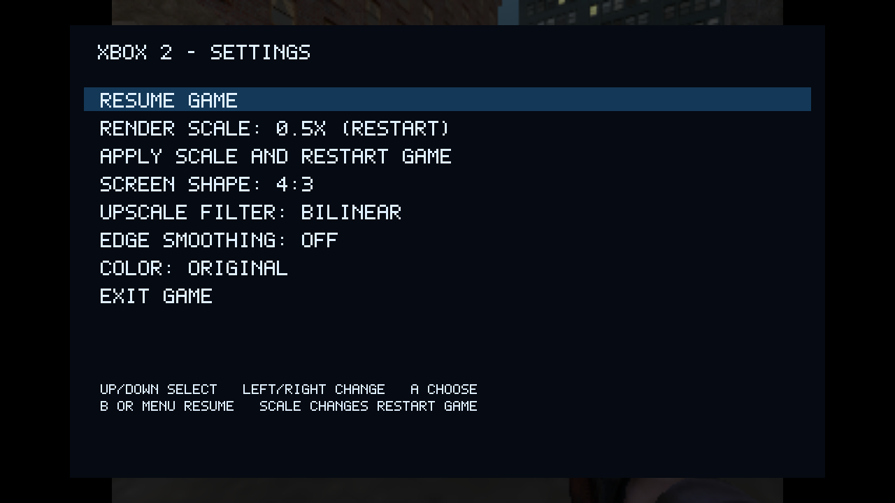

# hakuX for TrimUI Smart Pro — Xbox

An experimental original Xbox emulator port for the **original TrimUI Smart Pro
(TG5040, Cortex-A53, PowerVR GE8300, 1 GiB RAM)**, based on
[rfandango/hakuX](https://github.com/rfandango/hakuX).

**Controller mapping + automatic UI memory release: 2026.10.30.** Launching an Xbox
game closes the TrimUI frontend and OSD to free up additonal RAM; exiting restores both. No menu
option or configuration is required. An independent guard also restores
them if the launcher dies. Controller Mapping saves button assignments for
all games and includes Reset to defaults.

This package installs one **Xbox** system entry
and reads games from the existing **`Roms/XBOX`** folder. 

## Download and install

1. Download [the ready-to-install ZIP](release/xbox-trimui-smart-pro-2026.10.30.zip)
   using the file page's download button, or from this repository's Releases.
2. Exit any game and power off the handheld. Put its SD card in a computer.
3. Extract the ZIP. Copy its **`Data`** and **`Emus`** folders into the SD card's
   Data and Emus folders. Keep the directory names exactly as provided.
4. Put your own Xbox disc images in **`Roms/XBOX`**. Safely eject the SD card,
   reinsert it, start the handheld, and refresh the game list if necessary.
5. Open **Xbox**, select a game


## Controls and settings



*Earlier menu preview; the current menu also includes Frame skip and Controller Mapping.*

| Control | Action |
| --- | --- |
| Physical Menu button | Open the Xbox settings overlay |
| D-pad, A, B | Navigate, select, return/resume |
| Hold Start + Select for about 1.2 seconds | Exit to the handheld menu |
| L1 / R1 | Xbox white / black buttons |

The menu offers 0.35×, 0.5×, 0.75× and 1× render scale, screen shape,
edge smoothing, color presets, controller mapping and exit. Picture settings change live. A scale
change requires **Apply scale and restart game**; save in-game first.
0.75× is sharper than 0.5× but renders 2.25 times as many pixels; it may be
slower. A 640×480 game renders at 480×360 with 0.75×. The fresh-install default
remains 0.5×, and existing saved settings are preserved. Ordinary in-game saves are supported.

**To be added in next release**: Save/load states are being worked on & FPS display. 

**Frame skip: Off / Skip 1 (Display)** is in the Menu list. It defaults to Off,
changes live and saves between launches. Skip 1 omits alternate display updates
while preserving game rendering, texture generation and emulated timing. The
menu always updates normally. This is a display-only option; its speed benefit
may be small and motion can look choppier. It does not fix Halo 2 textures.

**Controller Mapping** lets you assign each Xbox button to a handheld button or trigger, or disable it. Up/Down selects an Xbox action; Left/Right or A changes its input. Changes apply on resume and persist for all games. Reset to defaults restores the original layout. Physical Menu, menu navigation and the Start + Select exit shortcut always retain their original controls.


## What to expect

This is an experimental port, with substantial game-specific limitations.
**A steady 30 FPS across all games is not promised.** Games can have missing or
black textures, visual glitches, slowdowns, crashes or driver stalls. Halo 2
still has black/missing textures; this release does not fix them but are being worked on. Lowering the
render scale may improve speed but does not repair incorrect rendering.

First-time shader compilation can cause stutter or temporary missing draws.
Allow it time, and keep the cache between sessions. Persistent black ground or
other incorrect surfaces are not guaranteed to disappear after compilation.

Smashing Drive, The Simpsons: Road Rage, Halo 2, Halo, GTA III, San Andreas, NFS UG2, Madden 2002, Nascar 2002, and Chicago Enforcer
have reached gameplay during testing. This does **not** establish complete
game compatibility or long-session stability. Test Drive has a known loading
problem. See [compatibility and limitations](docs/COMPATIBILITY.md).

**Swap is now set up automatically when launching any Xbox game.** The launcher
reuses existing configured/system swap, or creates one shared **512 MiB swap
file on internal ext4 storage** when at least **1 GiB is free**. First launch
can take longer while that file is prepared; later launches reuse it. If setup
is unavailable or fails, the game still launches and the reason is logged.
Existing swap configurations are preserved. Create an empty
`Data/ports/hakux/disable-swap` file to opt out of automatic setup. Swap can reduce memory-related exits,
but paging can cause pauses and does not guarantee an FPS improvement.

## Source and credits

This repository includes the current binary with limited device testing, the prior working
binary, pinned modified hakuX/FEX source snapshots, dependency source, Linux
platform code, feature patches and build scripts. The snapshots plus applied
patches provide the corresponding source without a large imported Git history.

Primary emulator work belongs to **rfandango and the hakuX contributors**.
FEX and the other component authors retain their credits and licenses.
This is a community port, not an official Xbox or TrimUI release.

The emulator is distributed under **GPL-3.0-or-later**, with component-specific
licenses retained. See [LICENSE](LICENSE), [COPYING](COPYING), and
[third-party notices](docs/LICENSES.md).


## Building from source

Requirements: Bash, Python 3.10+, CMake, Ninja, Zig 0.16.0 and `llvm-strip`
(or `aarch64-linux-gnu-strip`). The tested host was Apple Silicon macOS;
fresh Linux-host builds remain unverified. From the repository root:

```sh
python3 port/unpack-sources.py
```

Copy the target firmware's SDL2 shared library to `port/deps/lib/libSDL2.so`
for linking. The tested firmware provides
`/usr/trimui/lib/libSDL2-2.0.so.0.3000.8`; other firmware may use a different name.
With Zig and the strip tool on PATH:

```sh
export ZIG="$(command -v zig)"
export TRIMUI_STRIP="$(command -v llvm-strip)"
bash port/build-xbox2.sh
```

The stripped core is `port/dist/hakux.aarch64`. Pinned source revisions and
hashes are in `sources/SOURCES.json`. Preserve the bundled licenses when
distributing modified builds.
